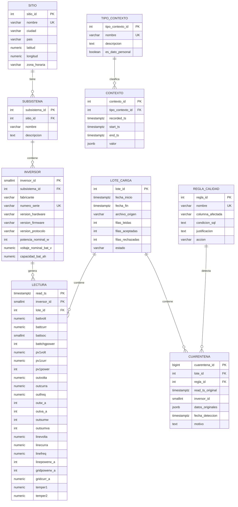

# 05 — Modelo Conceptual: Entidad-Relación de SolarDB

**Proyecto:** SolarDB — Integridad y calidad de datos en una microrred híbrida  
**Asignatura:** Bases de Datos I · Grupo 811 · Semestre 2026-II  
**Institución:** Institución Universitaria Pascual Bravo  
**Integrante responsable:** Deysi Carolina Echavarria Soto  
**Docente:** Ramiro Grisales Montoya  
**Fecha:** 2026-11-14  

---

## 1. Justificación del Formato de Almacenamiento: Ancho vs. Largo

Antes de diseñar el modelo entidad-relación, es necesario resolver una decisión arquitectónica fundamental: ¿cómo almacenar las lecturas de telemetría?

### 1.1. Descripción de los Formatos

**Formato ancho (wide):** Una fila por instante de muestreo y por inversor, con todas las variables como columnas independientes.

```
| read_ts              | inverter | battvolt | battcurr | pv1power | outsumw | temper1 | ... |
|----------------------|----------|----------|----------|----------|---------|---------|-----|
| 2025-07-12 13:31:35  | 1        | 52.40    | -12.30   | 1250     | 2100    | 32.5    | ... |
| 2025-07-12 13:31:48  | 1        | 52.38    | -12.10   | 1248     | 2098    | 32.5    | ... |
```

**Formato largo (tall/narrow):** Una fila por instante, por inversor y por variable.

```
| read_ts              | inverter | variable_id | valor   |
|----------------------|----------|-------------|---------|
| 2025-07-12 13:31:35  | 1        | battvolt    | 52.40   |
| 2025-07-12 13:31:35  | 1        | battcurr    | -12.30  |
| 2025-07-12 13:31:35  | 1        | pv1power    | 1250    |
| ...                  | ...      | ...         | ...     |
```

### 1.2. Análisis Comparativo Detallado

#### A. Volumen de Almacenamiento

| Criterio | Formato Ancho | Formato Largo |
|----------|---------------|---------------|
| **Filas totales** | 2,989,759 | 2,989,759 × 42 variables ≈ **125,569,878 filas** |
| **Columnas por fila** | 44 (read_ts + inverter + 42 variables) | 4 (read_ts, inverter, variable_id, valor) |
| **Tamaño estimado por fila** | ~350 bytes (44 columnas × ~8 bytes promedio) | ~40 bytes (4 columnas) |
| **Tamaño total estimado** | ~1.05 GB | ~5.02 GB |
| **Sobrecarga de índice PK** | PK compuesta `(read_ts, inverter)`: ~70 MB | PK compuesta `(read_ts, inverter, variable_id)`: ~3.8 GB |
| **Factor de multiplicación** | 1× | **~42×** en filas, **~4.8×** en espacio total |

> [!WARNING]
> El formato largo multiplica las filas por 42 (una por cada variable física), pasando de ~3 millones a ~125 millones de filas. En un proyecto académico con PostgreSQL en una máquina de escritorio, esto impactaría severamente el rendimiento de las consultas analíticas y el tiempo de migración.

#### B. Normalización

| Criterio | Formato Ancho | Formato Largo |
|----------|---------------|---------------|
| **1FN** | ✅ Cumple: cada celda almacena un valor atómico escalar | ✅ Cumple |
| **2FN** | ✅ Cumple: todas las 42 variables dependen funcionalmente de la clave completa `(read_ts, inverter)`, ya que cada variable se mide en ese instante para ese inversor específico | ✅ Cumple |
| **3FN** | ✅ Cumple: no existen dependencias transitivas entre las variables eléctricas (ver análisis en sección D) | ✅ Cumple |
| **Evaluación** | El formato ancho **ya está normalizado** para datos de telemetría instantánea | Normalización equivalente, sin ventaja adicional |

> [!IMPORTANT]
> **¿El formato ancho viola la normalización?** No. Un error conceptual común es pensar que "muchas columnas = desnormalizado". La normalización se evalúa por las **dependencias funcionales**, no por la cantidad de columnas. Cada variable física (`battvolt`, `pv1power`, `outsumw`, etc.) depende funcionalmente de `(read_ts, inverter)` porque es el valor medido por ese inversor en ese instante. No existe dependencia parcial (ninguna variable depende solo de `read_ts` o solo de `inverter`) ni transitiva (ninguna variable determina a otra — `battvolt` no determina `battcurr` en el sentido funcional).

#### C. Velocidad de Consultas Analíticas

Las consultas de negocio más importantes del proyecto son agregaciones temporales. Ejemplo: energía solar diaria por inversor.

**En formato ancho:**
```sql
SELECT inverter,
       date_trunc('day', read_ts) AS dia,
       SUM(pv1power * intervalo_s) / 3600000.0 AS energia_solar_kwh
FROM   lectura
GROUP BY inverter, dia;
```
- Accede a una sola tabla, una sola columna (`pv1power`).
- PostgreSQL lee secuencialmente las filas necesarias.
- Un índice B-tree sobre `(inverter, read_ts)` permite *index scan* eficiente.

**En formato largo:**
```sql
SELECT l.inverter,
       date_trunc('day', l.read_ts) AS dia,
       SUM(l.valor * intervalo_s) / 3600000.0 AS energia_solar_kwh
FROM   lectura_valor l
JOIN   variable v ON l.variable_id = v.id
WHERE  v.nombre = 'pv1power'
GROUP BY l.inverter, dia;
```
- Requiere JOIN con la tabla de variables.
- Debe filtrar 125 millones de filas para quedarse con las ~3 millones de `pv1power`.
- El resto de las filas (97.6%) son descartadas después de leerse.

| Métrica | Formato Ancho | Formato Largo |
|---------|---------------|---------------|
| **Filas leídas** para calcular energía solar diaria | ~2,989,759 | ~125,569,878 (filtra 97.6%) |
| **JOINs necesarios** | 0 | 1 (con tabla de variables) |
| **Rendimiento estimado** | Rápido | ~5-10× más lento |

#### D. Velocidad de Inserciones Masivas

| Criterio | Formato Ancho | Formato Largo |
|----------|---------------|---------------|
| **Filas a insertar** (migración total) | 2,989,759 | ~125,569,878 |
| **Sentencias `COPY`** | 1 ejecución sobre ~3M filas | 1 ejecución sobre ~126M filas |
| **Tiempo estimado** (con `COPY FROM` y SSD) | ~30-60 segundos | ~10-20 minutos |
| **Índices a mantener** | 1 PK compuesta | 1 PK compuesta (mucho más grande) |

#### E. Flexibilidad para Agregar Nuevas Variables

| Criterio | Formato Ancho | Formato Largo |
|----------|---------------|---------------|
| **Agregar una variable nueva** | `ALTER TABLE ADD COLUMN` (operación DDL) | `INSERT` en la tabla de catálogo de variables (operación DML) |
| **Impacto** | Requiere migración de esquema | No requiere cambio de esquema |
| **Relevancia para SolarDB** | **Baja**: el dataset OpenCEM tiene variables fijas definidas por hardware Modbus; no se agregarán variables nuevas | Alta en sistemas IoT genéricos |

> [!NOTE]
> En nuestro proyecto, las variables están definidas por el mapa de registros Modbus del inversor y no cambiarán. Esta ventaja del formato largo no aplica a SolarDB.

#### F. Integridad Referencial y Restricciones

| Criterio | Formato Ancho | Formato Largo |
|----------|---------------|---------------|
| **CHECK por variable** | `CHECK (battvolt BETWEEN 0 AND 60)` — una restricción específica por columna | Un solo `CHECK (valor BETWEEN min AND max)` genérico, o lógica compleja con CASEs |
| **Dominios PostgreSQL** | `CREATE DOMAIN voltaje_dc AS NUMERIC CHECK (VALUE BETWEEN 0 AND 600)` aplicable directamente | Dominio genérico `valor_medicion` que no puede diferenciar rangos |
| **NOT NULL selectivo** | `battvolt NOT NULL` independiente de `temper3` (que sí puede ser NULL) | No es posible: la columna `valor` es NULL o no es NULL para todas las variables por igual |
| **Tipos de dato diferenciados** | `battvolt NUMERIC(5,2)`, `pv1power INTEGER`, `battsoc SMALLINT` | Una sola columna `valor` de tipo `NUMERIC` o `DOUBLE PRECISION` para todo |

> [!IMPORTANT]
> El formato ancho permite definir **dominios PostgreSQL específicos** para cada variable física, que es exactamente lo que la línea de profundización SolarDB exige: "integridad y calidad de datos con restricciones y dominios". El formato largo hace imposible este nivel de granularidad declarativa.

### 1.3. Decisión: Formato Ancho (Wide)

**Se adopta el formato ancho** por las siguientes razones, en orden de importancia:

1. **Integridad declarativa granular**: Permite definir dominios PostgreSQL, restricciones CHECK y NOT NULL específicas para cada variable física, alineado directamente con la línea de profundización SolarDB.
2. **Rendimiento de consultas**: Las 10+ consultas analíticas del Taller 6 operan sobre columnas específicas (energía solar, SOC de batería, potencia de red). El formato ancho evita JOINs y filtra 42× menos filas.
3. **Volumen manejable**: 2,989,759 filas vs. 125,569,878 filas. En un entorno académico con PostgreSQL en máquina local, la diferencia es crítica.
4. **Normalización equivalente**: Ambos formatos cumplen 3FN para datos de telemetría instantánea. El formato ancho no viola ninguna forma normal.
5. **Migración eficiente**: La carga masiva con `COPY FROM` sobre ~3M filas es directa y rápida.

**Desnormalizaciones intencionales del formato ancho: Ninguna.** El formato ancho para `analog_measurements` no constituye una desnormalización porque todas las variables dependen funcionalmente de la clave `(read_ts, inverter)`.

---

## 2. Entidades Identificadas y Justificación

A partir del análisis del dataset OpenCEM y los requisitos de SolarDB, se identifican las siguientes entidades:

### 2.1. Entidades Incluidas

| # | Entidad | Justificación | Origen en el Dataset |
|---|---------|---------------|----------------------|
| 1 | **Sitio** (`sitio`) | Representa el campus o ubicación física donde se instala la microrred. Permite escalar a múltiples sitios sin rediseñar. Elimina la dependencia transitiva `inversor → subsistema → sitio`. | Implícito: campus CUHK-Shenzhen |
| 2 | **Subsistema** (`subsistema`) | Cada microrred tiene 2 subsistemas independientes (cómputo y climatización). Agrupa los componentes físicos y permite asociar cargas. | Implícito: inversor 1 → cómputo, inversor 2 → HVAC |
| 3 | **Inversor** (`inversor`) | Entidad central del sistema. Cada inversor tiene atributos estáticos de fábrica (fabricante, serial, firmware). Es la FK de todas las lecturas. | Tabla `specs` del SQLite: `manufacturename`, `sourcesn`, `hwver_m1` |
| 4 | **Lectura de Telemetría** (`lectura`) | Entidad principal: cada fila de `analog_measurements`. Contiene las 42 variables físicas medidas en un instante por un inversor. | Tabla `analog_measurements`: 2,989,759 filas |
| 5 | **Registro de Contexto** (`contexto`) | Anotaciones semiestructuradas (JSON) que relacionan eventos humanos con la telemetría. | Tabla `context`: 25,178 filas |
| 6 | **Tipo de Contexto** (`tipo_contexto`) | Catálogo de las fuentes de contexto (`manual entry`, `workstation1_log`, etc.). Normaliza el campo `source` del JSON. | Campo `$.source` en `context.value` |
| 7 | **Lote de Carga** (`lote_carga`) | Trazabilidad de cada proceso de migración masiva: cuántas filas se cargaron, cuántas se aceptaron, cuántas se rechazaron. Requerido por SolarDB. | Diseño propio de SolarDB |
| 8 | **Regla de Calidad** (`regla_calidad`) | Catálogo de las reglas de validación que SolarDB aplica (ej. "temperatura entre -10 y 60°C", "P ≤ S en CA"). | Diseño propio: doc `04_matriz_reglas_calidad.md` |
| 9 | **Registro de Cuarentena** (`cuarentena`) | Almacena las lecturas rechazadas con el motivo, la regla violada y la trazabilidad al lote de carga. | Diseño propio de SolarDB |

### 2.2. Entidades Evaluadas y Descartadas

| Entidad Candidata | Razón del Descarte |
|-------------------|--------------------|
| **Variable Física / Tipo de Variable** | Se descarta como entidad independiente porque se adoptó el formato ancho. En formato largo sería obligatoria como catálogo FK. En formato ancho, las variables son columnas, y su documentación se encuentra en el diccionario de datos (doc 08). |
| **Unidad de Medida** | Se descarta como entidad independiente por la misma razón: en formato ancho, las unidades se documentan en el diccionario de datos y se implementan mediante dominios PostgreSQL (`CREATE DOMAIN`), no como FK a un catálogo. |

---

## 3. Atributos por Entidad

### 3.1. Sitio

| Atributo | Tipo | Restricciones | Descripción |
|----------|------|---------------|-------------|
| `sitio_id` | SERIAL | **PK** | Identificador del sitio |
| `nombre` | VARCHAR(100) | NOT NULL, UNIQUE | Nombre del campus o instalación |
| `ciudad` | VARCHAR(100) | NOT NULL | Ciudad donde se ubica |
| `pais` | VARCHAR(60) | NOT NULL | País |
| `latitud` | NUMERIC(9,6) | | Coordenada geográfica |
| `longitud` | NUMERIC(9,6) | | Coordenada geográfica |
| `zona_horaria` | VARCHAR(40) | NOT NULL, DEFAULT 'Asia/Hong_Kong' | Zona horaria IANA |

### 3.2. Subsistema

| Atributo | Tipo | Restricciones | Descripción |
|----------|------|---------------|-------------|
| `subsistema_id` | SERIAL | **PK** | Identificador del subsistema |
| `sitio_id` | INTEGER | **FK → sitio**, NOT NULL | Sitio al que pertenece |
| `nombre` | VARCHAR(100) | NOT NULL | Nombre descriptivo (ej. "Cómputo GPU", "Climatización HVAC") |
| `descripcion` | TEXT | | Descripción de la carga que alimenta |

### 3.3. Inversor

| Atributo | Tipo | Restricciones | Descripción |
|----------|------|---------------|-------------|
| `inversor_id` | SMALLINT | **PK** | ID del inversor (1 o 2) — coincide con el campo `inverter` del dataset |
| `subsistema_id` | INTEGER | **FK → subsistema**, NOT NULL | Subsistema al que pertenece |
| `fabricante` | VARCHAR(100) | NOT NULL | Nombre del fabricante (de `specs.manufacturename`) |
| `numero_serie` | VARCHAR(50) | NOT NULL, UNIQUE | Número de serial (de `specs.sourcesn`) |
| `version_hardware` | VARCHAR(30) | | Versión de hardware (de `specs.hwver_m1`) |
| `version_firmware` | VARCHAR(30) | | Versión de firmware |
| `version_protocolo` | VARCHAR(30) | | Versión del protocolo Modbus |
| `potencia_nominal_w` | INTEGER | CHECK (> 0) | Potencia nominal del inversor en watts |
| `voltaje_nominal_bat_v` | NUMERIC(5,1) | CHECK (> 0) | Voltaje nominal del banco de baterías (51.2 V) |
| `capacidad_bat_ah` | NUMERIC(6,1) | CHECK (> 0) | Capacidad del banco de baterías (~200 Ah) |

### 3.4. Lectura de Telemetría

| Atributo | Tipo | Restricciones | Descripción |
|----------|------|---------------|-------------|
| `read_ts` | TIMESTAMPTZ | **PK** (compuesta) | Marca de tiempo UTC de la lectura |
| `inversor_id` | SMALLINT | **PK** (compuesta), **FK → inversor** | Inversor que registró la lectura |
| `lote_id` | INTEGER | **FK → lote_carga** | Lote de migración que cargó este registro |
| `battvolt` | NUMERIC(5,2) | Dominio `voltaje_dc` | Voltaje del banco de baterías (V) |
| `battcurr` | NUMERIC(5,2) | Dominio `corriente` | Corriente de batería (A) |
| `battsoc` | SMALLINT | Dominio `porcentaje` | Estado de carga (%) |
| `battchgpower` | INTEGER | | Potencia de carga/descarga batería (W) |
| `pv1volt` | NUMERIC(6,2) | Dominio `voltaje_dc` | Voltaje arreglo solar (V) |
| `pv1curr` | NUMERIC(5,2) | Dominio `corriente` | Corriente arreglo solar (A) |
| `pv1power` | INTEGER | CHECK (>= 0) | Potencia solar generada (W) |
| `outvolta` | NUMERIC(6,2) | Dominio `voltaje_ac` | Voltaje salida CA (V) |
| `outcurra` | NUMERIC(5,2) | Dominio `corriente` | Corriente salida CA (A) |
| `outfreq` | NUMERIC(5,2) | Dominio `frecuencia` | Frecuencia de salida (Hz) |
| `outw_a` | INTEGER | CHECK (>= 0) | Potencia activa a carga (W) |
| `outva_a` | INTEGER | CHECK (>= 0) | Potencia aparente a carga (VA) |
| `outsumw` | INTEGER | CHECK (>= 0) | Potencia activa total (W) |
| `outsumva` | INTEGER | CHECK (>= 0) | Potencia aparente total (VA) |
| `linevolta` | NUMERIC(6,2) | Dominio `voltaje_ac` | Voltaje de red CA (V) |
| `linecurra` | NUMERIC(5,2) | Dominio `corriente` | Corriente de red (A) |
| `linefreq` | NUMERIC(5,2) | Dominio `frecuencia` | Frecuencia de red (Hz) |
| `linepowerw_a` | INTEGER | | Potencia activa de red (W) |
| `gridpowerw_a` | INTEGER | | Potencia neta de red (W) |
| `gridcurr_a` | NUMERIC(5,2) | Dominio `corriente` | Corriente neta de red (A) |
| `temper1` | NUMERIC(4,1) | Dominio `temperatura` | Temperatura sensor 1 (°C) |
| `temper2` | NUMERIC(4,1) | Dominio `temperatura` | Temperatura sensor 2 (°C) |
| ... | ... | ... | *(demás columnas de analog_measurements — ver diccionario de datos doc 08)* |

> [!NOTE]
> Se listan aquí las variables principales. La tabla completa incluye las 42 variables físicas documentadas en `01_inventario_dataset.md`. Las columnas de reserva (`battreserve`, `pvreserve`, `otherreserve`, `grid_reserve`) se migran como JSONB por su naturaleza semiestructurada.

### 3.5. Registro de Contexto

| Atributo | Tipo | Restricciones | Descripción |
|----------|------|---------------|-------------|
| `contexto_id` | INTEGER | **PK** | ID del evento de contexto (corresponde a `context.id`) |
| `tipo_contexto_id` | INTEGER | **FK → tipo_contexto**, NOT NULL | Tipo/fuente del registro |
| `recorded_ts` | TIMESTAMPTZ | | Momento en que se persistió el registro |
| `start_ts` | TIMESTAMPTZ | | Inicio de la ventana de validez |
| `end_ts` | TIMESTAMPTZ | | Fin de la ventana de validez |
| `valor` | JSONB | | Carga útil del evento en formato JSONB |

### 3.6. Tipo de Contexto

| Atributo | Tipo | Restricciones | Descripción |
|----------|------|---------------|-------------|
| `tipo_contexto_id` | SERIAL | **PK** | Identificador del tipo |
| `nombre` | VARCHAR(50) | NOT NULL, UNIQUE | Nombre de la fuente (`manual entry`, `workstation1_log`, etc.) |
| `descripcion` | TEXT | | Descripción del tipo de contexto |
| `es_dato_personal` | BOOLEAN | NOT NULL, DEFAULT FALSE | Indica si contiene datos personales (Ley 1581) |

### 3.7. Lote de Carga

| Atributo | Tipo | Restricciones | Descripción |
|----------|------|---------------|-------------|
| `lote_id` | SERIAL | **PK** | Identificador del lote |
| `fecha_inicio` | TIMESTAMPTZ | NOT NULL, DEFAULT NOW() | Inicio de la carga |
| `fecha_fin` | TIMESTAMPTZ | | Fin de la carga |
| `archivo_origen` | VARCHAR(255) | NOT NULL | Nombre del archivo fuente |
| `filas_leidas` | INTEGER | CHECK (>= 0) | Total de filas leídas del origen |
| `filas_aceptadas` | INTEGER | CHECK (>= 0) | Filas que pasaron validación |
| `filas_rechazadas` | INTEGER | CHECK (>= 0) | Filas enviadas a cuarentena |
| `estado` | VARCHAR(20) | NOT NULL, DEFAULT 'en_proceso' | Estado: `en_proceso`, `completado`, `fallido` |

### 3.8. Regla de Calidad

| Atributo | Tipo | Restricciones | Descripción |
|----------|------|---------------|-------------|
| `regla_id` | SERIAL | **PK** | Identificador de la regla |
| `nombre` | VARCHAR(100) | NOT NULL, UNIQUE | Nombre descriptivo (ej. "Rango temperatura sensor") |
| `columna_afectada` | VARCHAR(50) | NOT NULL | Columna sobre la que aplica |
| `condicion_sql` | TEXT | NOT NULL | Expresión SQL de la condición CHECK |
| `justificacion` | TEXT | NOT NULL | Justificación física o de negocio |
| `accion` | VARCHAR(20) | NOT NULL | Acción: `rechazar`, `advertir`, `aceptar_con_marca` |

### 3.9. Registro de Cuarentena

| Atributo | Tipo | Restricciones | Descripción |
|----------|------|---------------|-------------|
| `cuarentena_id` | BIGSERIAL | **PK** | Identificador del registro |
| `lote_id` | INTEGER | **FK → lote_carga**, NOT NULL | Lote de carga donde se detectó |
| `regla_id` | INTEGER | **FK → regla_calidad**, NOT NULL | Regla de calidad que violó |
| `read_ts_original` | TIMESTAMPTZ | NOT NULL | Timestamp original de la lectura rechazada |
| `inversor_id` | SMALLINT | NOT NULL | Inversor de origen |
| `datos_originales` | JSONB | NOT NULL | Fila completa original como JSONB |
| `fecha_deteccion` | TIMESTAMPTZ | NOT NULL, DEFAULT NOW() | Momento de detección del error |
| `motivo` | TEXT | | Descripción del motivo de rechazo |

---

## 4. Relaciones, Cardinalidades y Participación

| # | Relación | Cardinalidad | Participación | Descripción |
|---|----------|-------------|---------------|-------------|
| R1 | Sitio **tiene** Subsistemas | 1:N | Sitio: parcial / Subsistema: total | Un sitio puede tener uno o más subsistemas; todo subsistema pertenece a exactamente un sitio. |
| R2 | Subsistema **contiene** Inversores | 1:N | Subsistema: parcial / Inversor: total | Un subsistema puede tener uno o más inversores; todo inversor pertenece a exactamente un subsistema. |
| R3 | Inversor **genera** Lecturas | 1:N | Inversor: parcial / Lectura: total | Un inversor genera cero o más lecturas; toda lectura pertenece a exactamente un inversor. |
| R4 | Tipo de Contexto **clasifica** Contextos | 1:N | Tipo: parcial / Contexto: total | Un tipo clasifica cero o más contextos; todo contexto tiene exactamente un tipo. |
| R5 | Lote de Carga **contiene** Lecturas | 1:N | Lote: parcial / Lectura: total | Un lote agrupa las lecturas migradas en ese proceso; toda lectura pertenece a un lote. |
| R6 | Lote de Carga **contiene** Cuarentenas | 1:N | Lote: parcial / Cuarentena: total | Un lote puede generar cero o más registros de cuarentena. |
| R7 | Regla de Calidad **detecta** Cuarentenas | 1:N | Regla: parcial / Cuarentena: total | Una regla puede detectar múltiples violaciones; cada registro en cuarentena fue detectado por exactamente una regla. |

---

## 5. Diagrama Entidad-Relación (Mermaid)



---

## 6. Decisiones de Diseño Relevantes

### 6.1. Clave Primaria de Lectura: `(read_ts, inversor_id)`

Se mantiene la clave compuesta natural del dataset original. El coordinador (Juan Sebastian) verificó empíricamente que existen **cero duplicados** en la combinación `(read_ts, inverter)` sobre las 2,989,759 filas. Esto la hace una clave primaria natural confiable sin necesidad de un surrogate key (BIGSERIAL), ahorrando 8 bytes por fila (~24 MB) y evitando un índice adicional.

### 6.2. Conversión de `read_ts` de REAL a TIMESTAMPTZ

El campo `read_ts` original es un `REAL` (float64 Unix timestamp). Se convierte a `TIMESTAMPTZ` de PostgreSQL porque:
- Permite operaciones temporales nativas (`date_trunc`, `INTERVAL`, `EXTRACT`).
- Indexación B-tree determinista (sin errores de redondeo flotante).
- Soporte nativo de zonas horarias.
- Fórmula de conversión: `to_timestamp(read_ts)` o `'epoch'::timestamptz + read_ts * INTERVAL '1 second'`.

### 6.3. Separación de Contexto en Entidad + Tipo

El campo `value` de la tabla `context` del SQLite contiene JSON con un campo `source` que categoriza el tipo de evento. En lugar de dejar esa clasificación embebida en el JSON, se normaliza en una tabla `tipo_contexto` con una FK, permitiendo:
- Consultas eficientes por tipo sin parsear JSON.
- Marcar qué tipos contienen datos personales (Ley 1581).
- Integridad referencial.

### 6.4. Cuarentena como Entidad Independiente

Los registros rechazados no se eliminan ni se mezclan con los datos válidos. Se almacenan en una tabla de cuarentena con:
- Referencia al lote de carga (trazabilidad temporal).
- Referencia a la regla violada (trazabilidad causal).
- Los datos originales completos en JSONB (para auditoría y posible recuperación).

---

## 7. Cita Bibliográfica

Bartels, T. S., Wu, R., Lu, X., Chen, Y., Lu, Y., Xia, F., Yang, H., Chen, Y., & Li, T. (2026). OpenCEM: Multimodal photovoltaic and battery microgrid dataset with context records and sky imagery (Version 1.0.0) [Dataset]. Zenodo. https://doi.org/10.5281/zenodo.21436223
