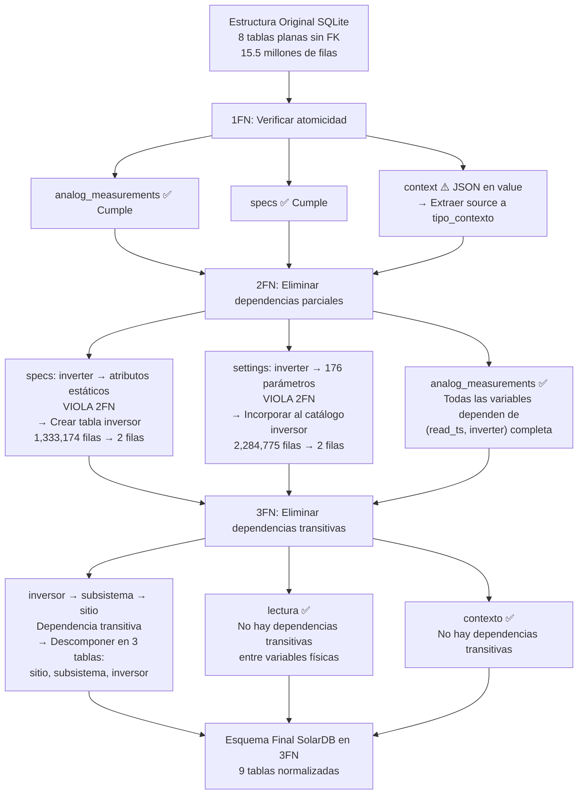

# 07 — Normalización hasta Tercera Forma Normal (3FN)

**Proyecto:** SolarDB — Integridad y calidad de datos en una microrred híbrida  
**Asignatura:** Bases de Datos I · Grupo 811 · Semestre 2026-II  
**Institución:** Institución Universitaria Pascual Bravo  
**Integrante responsable:** Deysi Carolina Echavarria Soto  
**Docente:** Ramiro Grisales Montoya  
**Fecha:** 2026-11-14  

---

## 1. Introducción

Este documento demuestra paso a paso el proceso de normalización desde la estructura original del dataset OpenCEM (SQLite plano) hasta la Tercera Forma Normal (3FN) en el esquema PostgreSQL de SolarDB.

Se utilizan datos reales del dataset y se identifican las dependencias funcionales, anomalías y descomposiciones en cada etapa.

---

## 2. Estructura Original del Dataset (Antes de Normalizar)

El dataset OpenCEM almacena toda la información en tablas planas sin integridad referencial:

### 2.1. Tabla `analog_measurements` (la tabla principal)

**Clave primaria original:** `(read_ts, inverter)` — verificada sin duplicados (2,989,759 filas).

| Columna | Ejemplo Real (Inversor 1, 2025-07-12) |
|---------|----------------------------------------|
| `read_ts` | 1752326895.123 (Unix float) |
| `inverter` | 1 |
| `battvolt` | 52.40 |
| `battcurr` | -12.30 |
| `battsoc` | 78 |
| `pv1volt` | 387.20 |
| `pv1power` | 1250 |
| `outsumw` | 2100 |
| `temper1` | 32.5 |
| ... | *(42 variables físicas en total)* |

### 2.2. Tabla `specs` (especificaciones de hardware)

**Clave primaria original:** `(read_ts, inverter)` — 1,333,174 filas.

| Columna | Ejemplo Real (Inversor 1) | Ejemplo Real (Inversor 2) |
|---------|---------------------------|---------------------------|
| `read_ts` | 1752326895.123 | 1752469412.789 |
| `inverter` | 1 | 2 |
| `machcode` | 527 | 527 |
| `manufacturename` | Voltronic Power | Voltronic Power |
| `sourcesn` | 93241303102595 | 93241303102608 |
| `hwver_m1` | 71.90 | 71.90 |
| `protocolver` | CPI,P31 | CPI,P31 |
| `bmsver` | PACE-BMS | PACE-BMS |
| ... | *(16 columnas)* | |

> [!WARNING]
> **Problema:** Los valores de `manufacturename`, `sourcesn`, `hwver_m1`, etc. son **constantes de fábrica** que no cambian con el tiempo. Sin embargo, se repiten en cada una de las 1,333,174 filas (una por cada instante de muestreo × inversor). Esto es redundancia masiva.

### 2.3. Tabla `context` (registros de contexto)

| Columna | Ejemplo Real |
|---------|--------------|
| `id` | 1 |
| `recorded` | 1721841600 |
| `start` | 1721817600 |
| `end` | 1721904000 |
| `value` | `{"source": "manual entry", "textual_description": "university semester break"}` |

---

## 3. Primera Forma Normal (1FN)

### 3.1. Definición

Una tabla está en 1FN si:
1. Todos los atributos contienen **valores atómicos** (indivisibles).
2. No hay **grupos repetitivos** ni columnas con múltiples valores.
3. Existe una **clave primaria** definida.

### 3.2. Análisis de `analog_measurements`

| Criterio 1FN | Cumple | Evidencia |
|-------------|--------|-----------|
| Valores atómicos | ✅ Sí | Cada celda contiene un valor escalar: `battvolt = 52.40`, `battsoc = 78`, etc. No hay arrays ni listas en las columnas numéricas. |
| Sin grupos repetitivos | ✅ Sí | Las 42 variables son columnas independientes, no una lista dentro de una celda. |
| Clave primaria | ✅ Sí | `(read_ts, inverter)` — sin duplicados verificados sobre 2,989,759 filas. |

**Excepción identificada:** Las columnas `battreserve`, `pvreserve`, `otherreserve` y `grid_reserve` contienen cadenas de texto que en algunos casos representan datos semiestructurados o NULL. Estos son registros de reserva del protocolo Modbus (bytes sin parsear).

**Resolución:** En SolarDB se migran como tipo `JSONB`, que es atómico desde la perspectiva de PostgreSQL (un valor por celda). El contenido interno del JSON no viola 1FN porque PostgreSQL trata JSONB como un tipo de dato nativo, no como un grupo repetitivo.

### 3.3. Análisis de `specs`

| Criterio 1FN | Cumple | Evidencia |
|-------------|--------|-----------|
| Valores atómicos | ✅ Sí | Cada columna contiene un valor escalar: `manufacturename = 'Voltronic Power'`, `sourcesn = '93241303102595'`. |
| Sin grupos repetitivos | ✅ Sí | No hay arrays ni listas. |
| Clave primaria | ✅ Sí | `(read_ts, inverter)`. |

### 3.4. Análisis de `context`

| Criterio 1FN | Cumple | Problema |
|-------------|--------|---------|
| Valores atómicos | ⚠️ Parcial | La columna `value` contiene un **objeto JSON completo** como texto. Ejemplo: `{"source": "manual entry", "textual_description": "university semester break"}` |
| Clave primaria | ✅ Sí | `id` (autoincremental). |

**Violación de 1FN en `context.value`:**

El campo `value` almacena un JSON con múltiples propiedades internas (`source`, `textual_description`, y otras según el tipo de evento). Esto **puede considerarse una violación de 1FN** si las propiedades internas son atributos que necesitan consultarse independientemente.

**Resolución aplicada en SolarDB:**

1. Se extrae `source` del JSON y se normaliza en una tabla catálogo `tipo_contexto` con FK.
2. El resto del JSON se conserva como `JSONB` porque:
   - Su estructura varía según el tipo de fuente (polimorfismo).
   - PostgreSQL proporciona operadores nativos para consultar JSONB (`->`, `->>`, `@>`, `jsonb_extract_path_text()`).
   - Crear una tabla relacional para cada tipo de JSON sería sobrediseño dado que solo hay 25,178 registros y 7 tipos de fuente distintos.

**Estructura DESPUÉS de 1FN para `context`:**

| Tabla | Columnas |
|-------|----------|
| `tipo_contexto` | `tipo_contexto_id` (PK), `nombre`, `descripcion`, `es_dato_personal` |
| `contexto` | `contexto_id` (PK), `tipo_contexto_id` (FK), `recorded_ts`, `start_ts`, `end_ts`, `valor` (JSONB sin el campo `source`) |

### 3.5. Conclusión de 1FN

| Tabla Original | Estado en 1FN | Acción |
|---------------|---------------|--------|
| `analog_measurements` | ✅ Cumple 1FN | Sin cambios |
| `specs` | ✅ Cumple 1FN | Sin cambios (los problemas son de 2FN) |
| `context` | ⚠️ Parcial → ✅ Corregida | Extracción de `source` a tabla catálogo |

---

## 4. Segunda Forma Normal (2FN)

### 4.1. Definición

Una tabla está en 2FN si:
1. Está en 1FN.
2. **No existen dependencias funcionales parciales:** todo atributo no clave depende de **toda** la clave primaria, no solo de una parte de ella.

> [!IMPORTANT]
> La 2FN solo aplica cuando la clave primaria es **compuesta** (tiene más de una columna). Si la PK es simple, la tabla cumple 2FN automáticamente.

### 4.2. Análisis de `specs` — Violación de 2FN (Caso Principal)

**Clave primaria compuesta:** `(read_ts, inverter)`

**Dependencias funcionales identificadas:**

```
Dependencias que involucran TODA la clave:
    (read_ts, inverter) → {todas las columnas}  -- dependencia trivial

Dependencias PARCIALES (solo parte de la clave):
    inverter → manufacturename
    inverter → sourcesn
    inverter → hwver_m1
    inverter → protocolver
    inverter → bmsver
    inverter → machcode
    inverter → ... (todos los atributos de specs)
```

**Evidencia real:** Los atributos de `specs` son constantes de fábrica que dependen **únicamente del inversor**, no del instante de lectura. El valor de `manufacturename` para el inversor 1 es siempre `'Voltronic Power'`, sin importar si `read_ts` es `2025-07-12` o `2026-06-22`.

**Demostración con datos reales:**

| read_ts (ejemplo) | inverter | manufacturename | sourcesn | hwver_m1 |
|-------------------|----------|-----------------|----------|----------|
| 1752326895.123 | 1 | Voltronic Power | 93241303102595 | 71.90 |
| 1752326907.456 | 1 | Voltronic Power | 93241303102595 | 71.90 |
| 1752326920.789 | 1 | Voltronic Power | 93241303102595 | 71.90 |
| ... ×1,333,174 filas | ... | **SIEMPRE IGUAL** por inversor | **SIEMPRE IGUAL** | **SIEMPRE IGUAL** |

**Anomalías causadas por esta violación:**

| Tipo de Anomalía | Descripción | Ejemplo |
|------------------|-------------|---------|
| **Anomalía de inserción** | No se puede registrar un inversor nuevo sin tener al menos una lectura temporal (`read_ts`). | Si se instala un inversor 3 pero aún no hay datos, no se puede almacenar su fabricante y serial. |
| **Anomalía de modificación** | Si el inversor actualiza su firmware, hay que actualizar las 1,333,174 filas (o las ~700,000 de ese inversor). | Cambiar `bmsver` de `'PACE-BMS'` a `'PACE-BMS-v2'` requiere un `UPDATE` masivo. |
| **Anomalía de eliminación** | Si se eliminan todas las lecturas de un periodo, se pierde la información del fabricante y serial. | Borrar lecturas de julio 2025 podría eliminar la única referencia al hardware del inversor. |

**Descomposición aplicada para alcanzar 2FN:**

Se extraen los atributos que dependen parcialmente de la clave (solo de `inverter`) en una tabla separada:

**ANTES (viola 2FN):**
```
specs(read_ts, inverter, machcode, manufacturename, sourcesn, hwver_m1, protocolver, bmsver, ...)
PK: (read_ts, inverter)
```

**DESPUÉS (cumple 2FN):**
```
inversor(inversor_id, fabricante, numero_serie, version_hardware, version_firmware, version_protocolo, ...)
PK: inversor_id

-- La tabla specs original ya no se necesita como tabla independiente.
-- Sus datos estáticos ahora viven en la tabla catálogo "inversor".
```

> [!NOTE]
> Esta descomposición elimina **~1,333,172 filas redundantes** (1,333,174 filas originales reducidas a solo 2 filas en la tabla `inversor`). La reducción es del **99.99985%** en esa tabla.

### 4.3. Análisis de `analog_measurements` — Cumple 2FN

**Clave primaria compuesta:** `(read_ts, inverter)`

**Dependencias funcionales:**

```
(read_ts, inverter) → battvolt       ✅ Depende de TODA la clave
(read_ts, inverter) → battcurr       ✅ Depende de TODA la clave
(read_ts, inverter) → pv1power       ✅ Depende de TODA la clave
(read_ts, inverter) → outsumw        ✅ Depende de TODA la clave
(read_ts, inverter) → temper1        ✅ Depende de TODA la clave
... (las 42 variables)
```

**¿Existe alguna dependencia parcial?**

- `read_ts → battvolt`? **NO.** El mismo timestamp puede tener lecturas diferentes para el inversor 1 y el inversor 2. El voltaje depende del instante Y del inversor.
- `inverter → battvolt`? **NO.** El mismo inversor tiene voltajes diferentes en cada instante de tiempo.

**Conclusión:** Todas las 42 variables físicas dependen funcionalmente de la clave completa `(read_ts, inverter)`. No hay dependencias parciales. La tabla `analog_measurements` **cumple 2FN**.

### 4.4. Análisis de `settings` — Violación de 2FN (análogo a `specs`)

**Clave primaria compuesta:** `(read_ts, inverter)` — 2,284,775 filas.

La tabla `settings` tiene **176 columnas** de parámetros de configuración del inversor (voltajes de corte, curvas de protección, banderas de control, contraseñas de usuario, etc.). Estos parámetros son **configuraciones del inversor** que cambian muy raramente (o nunca).

**Dependencia funcional parcial:**

```
inverter → {todos los 176 parámetros de settings}
```

Estos valores no dependen de `read_ts` porque la configuración del inversor no cambia cada 12 segundos. La tabla `settings` viola 2FN por la misma razón que `specs`.

**Resolución en SolarDB:** Los parámetros de `settings` no se migran como tabla de lecturas. Se incorporan como atributos del catálogo `inversor` o se almacenan como un registro JSONB de configuración vigente, ya que son datos estáticos del equipo.

> [!NOTE]
> La tabla `settings` no es parte de la migración principal de SolarDB (que se enfoca en `analog_measurements` y `context`). Sin embargo, este análisis demuestra que su diseño original viola 2FN y cómo SolarDB lo resuelve.

### 4.5. Resumen de 2FN

| Tabla Original | Violación 2FN | Dependencia Parcial | Descomposición |
|---------------|---------------|---------------------|----------------|
| `specs` | ✅ **Sí — VIOLACIÓN** | `inverter → {manufacturename, sourcesn, ...}` | Se crea tabla `inversor` con atributos estáticos |
| `settings` | ✅ **Sí — VIOLACIÓN** | `inverter → {176 parámetros}` | Parámetros al catálogo `inversor` |
| `analog_measurements` | ❌ No hay violación | Todas las variables dependen de `(read_ts, inverter)` completa | Sin cambios |
| `context` | ❌ No aplica (PK simple: `id`) | N/A | Sin cambios |

---

## 5. Tercera Forma Normal (3FN)

### 5.1. Definición

Una tabla está en 3FN si:
1. Está en 2FN.
2. **No existen dependencias transitivas:** ningún atributo no clave depende de otro atributo no clave.

Formalmente: si A → B y B → C, donde B no es clave, entonces C depende transitivamente de A a través de B. Esto viola 3FN.

### 5.2. Dependencia Transitiva Identificada: Inversor → Subsistema → Sitio

En el diseño SolarDB, el inversor pertenece a un subsistema, y el subsistema pertenece a un sitio:

```
inversor_id → subsistema_id       (cada inversor pertenece a un subsistema)
subsistema_id → sitio_id           (cada subsistema pertenece a un sitio)
subsistema_id → nombre_subsistema  (cada subsistema tiene un nombre)
sitio_id → nombre_sitio            (cada sitio tiene un nombre)
sitio_id → ciudad                  (cada sitio está en una ciudad)
```

**Dependencia transitiva potencial:**

Si almacenáramos todo en una sola tabla plana:

```
inversor_flat(inversor_id, fabricante, numero_serie, subsistema_nombre, sitio_nombre, ciudad, pais)
```

Entonces:
- `inversor_id → subsistema_nombre` (directo)
- `subsistema_nombre → sitio_nombre` (transitiva)
- `subsistema_nombre → ciudad` (transitiva)
- `subsistema_nombre → pais` (transitiva)

**ANTES (tabla plana hipotética — viola 3FN):**

| inversor_id | fabricante | numero_serie | subsistema_nombre | sitio_nombre | ciudad | pais |
|-------------|-----------|-------------|-------------------|-------------|--------|------|
| 1 | Voltronic Power | 93241303102595 | Cómputo GPU | CUHK-Shenzhen | Shenzhen | China |
| 2 | Voltronic Power | 93241303102608 | Climatización HVAC | CUHK-Shenzhen | Shenzhen | China |

**Anomalías de la dependencia transitiva:**

| Tipo de Anomalía | Descripción |
|------------------|-------------|
| **Anomalía de inserción** | No se puede registrar un sitio nuevo (ej. "Campus Medellín") sin tener al menos un inversor asignado. |
| **Anomalía de modificación** | Si el sitio "CUHK-Shenzhen" cambia de nombre, hay que actualizar las filas de TODOS los inversores de TODOS los subsistemas de ese sitio. |
| **Anomalía de eliminación** | Si se eliminan los dos inversores, se pierde toda la información del sitio y los subsistemas. |

**Descomposición aplicada para alcanzar 3FN:**

```
sitio(sitio_id, nombre, ciudad, pais, latitud, longitud, zona_horaria)
PK: sitio_id

subsistema(subsistema_id, sitio_id, nombre, descripcion)
PK: subsistema_id
FK: sitio_id → sitio(sitio_id)

inversor(inversor_id, subsistema_id, fabricante, numero_serie, ...)
PK: inversor_id
FK: subsistema_id → subsistema(subsistema_id)
```

Ahora cada entidad vive en su propia tabla:
- La información del sitio solo se almacena una vez en `sitio`.
- La información del subsistema solo se almacena una vez en `subsistema`.
- No hay dependencias transitivas.

### 5.3. Análisis de `analog_measurements` (ahora `lectura`) — Cumple 3FN

**¿Existen dependencias transitivas entre las variables físicas?**

Analicemos las relaciones físicas reales entre las variables:

| Relación Física | ¿Es dependencia funcional? | Justificación |
|----------------|---------------------------|---------------|
| `P = V × I` → ¿`pv1power` depende de `pv1volt` y `pv1curr`? | **NO es DF en sentido estricto** | Aunque físicamente `P = V × I`, en el dataset el inversor calcula `pv1power` internamente con precisión diferente a la lectura de `pv1volt × pv1curr`. Son tres mediciones independientes del DSP. No existe `(pv1volt, pv1curr) → pv1power` determinista en los datos reales. |
| `outsumw ≤ outsumva` (ley P ≤ S) | **NO es DF** | Es una restricción física (desigualdad), no una dependencia funcional (igualdad determinista). |
| `battvolt` y `battsoc` están correlacionadas | **NO es DF** | El SOC depende de la historia de carga/descarga, no solo del voltaje instantáneo. El mismo voltaje puede corresponder a diferentes SOC según la temperatura y la histéresis de la batería LiFePO4. |
| `temper1` y `temper2` | **NO es DF** | Son sensores independientes en ubicaciones diferentes del inversor (módulo vs. transformador). |

**Conclusión:** No existen dependencias funcionales transitivas entre las 42 variables físicas de `analog_measurements`. Cada variable es una **medición independiente** del sistema SCADA/Modbus en ese instante. La tabla `lectura` **cumple 3FN**.

### 5.4. Análisis de `contexto` — Cumple 3FN

| Columna no clave | ¿Depende de otra no clave? | Justificación |
|------------------|---------------------------|---------------|
| `tipo_contexto_id` | No | Es FK directa |
| `recorded_ts` | No | Timestamp independiente |
| `start_ts` | No | Inicio de ventana, independiente |
| `end_ts` | No | Fin de ventana, independiente |
| `valor` | ¿De `tipo_contexto_id`? | **NO**: el tipo determina la *estructura* del JSON, pero no su *contenido*. Dos contextos del mismo tipo tienen valores diferentes. |

La tabla `contexto` **cumple 3FN**.

### 5.5. Análisis de las tablas catálogo — Cumplen 3FN

Las tablas `sitio`, `subsistema`, `inversor`, `tipo_contexto`, `lote_carga`, `regla_calidad` y `cuarentena` tienen claves primarias simples (o una clave primaria en la que todos los atributos dependen directamente de ella). No hay dependencias transitivas en ninguna de ellas.

---

## 6. Resumen del Proceso Completo de Normalización



### Tabla de resumen

| Paso | Tabla Afectada | Problema | Anomalías | Solución | Resultado |
|------|---------------|----------|-----------|----------|-----------|
| **1FN** | `context` | Campo `value` con JSON que contiene `source` como atributo consultable | No se puede filtrar por tipo de contexto sin parsear JSON | Extraer `source` a tabla `tipo_contexto` con FK | ✅ 1FN |
| **2FN** | `specs` | `inverter → {manufacturename, sourcesn, ...}` — dependencia parcial | Inserción, modificación, eliminación de hardware | Crear tabla `inversor` con atributos estáticos | ✅ 2FN |
| **2FN** | `settings` | `inverter → {176 parámetros}` — dependencia parcial | 176 columnas repetidas en 2.28M filas | Incorporar al catálogo `inversor` | ✅ 2FN |
| **3FN** | Modelo jerárquico | `inversor → subsistema → sitio` — dependencia transitiva | No se puede crear sitio sin inversor | Descomponer en `sitio`, `subsistema`, `inversor` | ✅ 3FN |

---

## 7. Verificación Final: ¿El Esquema SolarDB Cumple 3FN?

| Tabla SolarDB | 1FN | 2FN | 3FN | Justificación |
|--------------|-----|-----|-----|---------------|
| `sitio` | ✅ | ✅ (PK simple) | ✅ | Todos los atributos dependen solo de `sitio_id`. No hay DFs entre `ciudad`, `pais`, `latitud`, etc. |
| `subsistema` | ✅ | ✅ (PK simple) | ✅ | `nombre` y `descripcion` dependen solo de `subsistema_id`. `sitio_id` es FK, no genera transitividad. |
| `inversor` | ✅ | ✅ (PK simple) | ✅ | Todos los atributos de hardware dependen de `inversor_id`. `subsistema_id` es FK. |
| `lectura` | ✅ | ✅ | ✅ | Las 42 variables dependen de `(read_ts, inversor_id)` completa. Sin DFs parciales ni transitivas. |
| `tipo_contexto` | ✅ | ✅ (PK simple) | ✅ | Atributos dependen solo de `tipo_contexto_id`. |
| `contexto` | ✅ | ✅ (PK simple) | ✅ | `tipo_contexto_id` es FK, no genera transitividad sobre los timestamps. |
| `lote_carga` | ✅ | ✅ (PK simple) | ✅ | Contadores dependen solo de `lote_id`. |
| `regla_calidad` | ✅ | ✅ (PK simple) | ✅ | Atributos dependen solo de `regla_id`. |
| `cuarentena` | ✅ | ✅ (PK simple) | ✅ | FKs a `lote_carga` y `regla_calidad` no generan transitividad. Los datos originales (JSONB) son un blob. |

**Conclusión:** Las 9 tablas del esquema SolarDB **cumplen la Tercera Forma Normal (3FN)**. No se aplicaron desnormalizaciones intencionales.

---

## 8. Impacto Cuantitativo de la Normalización

| Métrica | Antes (SQLite plano) | Después (SolarDB 3FN) | Reducción |
|---------|---------------------|----------------------|-----------|
| Filas en `specs` | 1,333,174 | 2 (tabla `inversor`) | **99.99985%** |
| Filas en `settings` | 2,284,775 | 2 (incorporadas en `inversor`) | **99.99991%** |
| Columnas en tabla principal | 44 (+ info de specs embebida) | 44 (sin redundancia de hardware) | Separación limpia |
| Redundancia de fabricante/serial | ~1,333,174 copias | 1 copia por inversor | Eliminada |
| Integridad referencial | 0 FKs | 7 FKs con políticas explícitas | De 0 a 7 |
| Catálogos independientes | 0 | 5 (sitio, subsistema, inversor, tipo_contexto, regla_calidad) | Creados |

---

## 9. Cita Bibliográfica

Bartels, T. S., Wu, R., Lu, X., Chen, Y., Lu, Y., Xia, F., Yang, H., Chen, Y., & Li, T. (2026). OpenCEM: Multimodal photovoltaic and battery microgrid dataset with context records and sky imagery (Version 1.0.0) [Dataset]. Zenodo. https://doi.org/10.5281/zenodo.21436223
